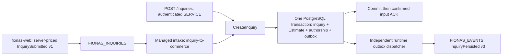

# Integrated inquiry intake

Commerce can run HTTP, one inquiry consumer and its outbox publisher in one JVM. Intake is
**disabled by default**. This change does not deploy either application or alter any broker
resource. The standalone worker remains the owner until an operator transfers ownership.



The shared composition function builds the same `CreateInquiry` operation for both entry
points. There is no localhost HTTP hop, service-token exchange, second pool or queue. An ACK
does not wait for success publication. Replays use the original event UUID **verbatim**, even
its letter case, as the existing submission key; same intent returns the committed inquiry
without another Estimate or outbox event. Different intent conflicts. Prior submissions
without a success outbox record remain historical; recovery never backfills events.

## Configuration and authority

| Variable | Meaning |
|---|---|
| `FIONAS_INTAKE_ENABLED` | Exactly `true` or `false`; absent means false |
| `FIONAS_INTAKE_NATS_URL` | One `nats://` or `tls://` URL, no credentials/path/query/fragment |
| `FIONAS_INTAKE_NATS_CREDS_FILE` | Readable mounted JWT/NKey credentials file |
| `FIONAS_INTAKE_NATS_USER`, `FIONAS_INTAKE_NATS_PASSWORD` | Nonblank username/password pair |
| `FIONAS_INTAKE_NATS_TOKEN` | Nonblank preshared broker token |

When enabled, exactly one NATS authentication method is required. Prefer a dedicated user
or mounted credentials and trusted TLS. Intake and outbox use separate connections and
credentials; shutting down one does not close the other. `FIONAS_NATS_*` continues to configure
only the outbox publisher. Disabled intake opens no connection and starts no thread.

The application captures the stable `OperationOrigin.Internal(InternalComponentId("fionas.inquiry-intake"))`
for intake and exact-sequence recovery. No commerce SERVICE, role, credential or permission lookup
is required. This origin records the component that committed the financial lines; the web
remains their pricing source. Historical SERVICE authorship stays unchanged. External HTTP
submission still authenticates a SERVICE and checks its live `fionas.inquiries.create` grant.

Internal attribution does not make an incoming event trustworthy. Broker authentication and
publish ACLs constrain transport; strict input validation and business invariants still apply.
Payload `source: fionas-web` is contract validation, **not authentication**. Payload origin,
component and `submittedBy` fields cannot select attribution. A shared broker token cannot
identify individual publishers or enforce per-user least privilege; every holder can submit
financial terms. Use it only in an appropriately trusted development environment.

### Bounded database shutdown

Released runtime 0.0.26 exposes blocking operations, not arbitrary-operation cancellation.
Intake therefore requires finite bounds through its existing runtime JDBC configuration:

```text
DATABASE_CONNECTION_TIMEOUT_MS=5000
# Append these query parameters to the existing DATABASE_JDBC_URL (use & if it already has ?):
socketTimeout=5&options=-c%20transaction_timeout%3D50000%20-c%20statement_timeout%3D5000
```

The options string decodes to `-c transaction_timeout=50000 -c statement_timeout=5000`.
The two `-c` assignments may appear in either order with ordinary whitespace; explicit
integer units such as `50s`/`5s` or `50000ms`/`5000ms` are equivalent. Disabled, longer,
duplicate, quoted or additional assignments are rejected. `socketTimeout` and `options`
must be query parameters in `DATABASE_JDBC_URL`, not separate environment variables.
Set them on the commerce application deployment and restart after changing its environment.

For example, retaining any existing connection parameters:

```text
jdbc:postgresql://HOST:PORT/DATABASE?socketTimeout=5&options=-c%20transaction_timeout%3D50000%20-c%20statement_timeout%3D5000
jdbc:postgresql://HOST:PORT/DATABASE?sslmode=require&socketTimeout=5&options=-c%20statement_timeout%3D5000%20-c%20transaction_timeout%3D50000
```

Startup diagnostics identify the failed setting, including the runtime's effective pool
connection timeout. Missing or duplicated query parameters are reported by name and count.
URL, query values and decoder exception details are never echoed. If a deployment still
prints the old combined error, it is running the earlier validator: compare its effective
pool timeout and only the `socketTimeout`/`options` parameters privately, without sharing
the full database URL or credentials.

`socketTimeout` may be 1–5 seconds; the whole transaction is bounded to 50s and each statement
to 5s. Intake refuses enablement without these explicit settings. These options apply to
**the existing shared pool**, including HTTP and migrations: verify migration and workload
compatibility while dormant before cutover. A future migration needing longer than 5s must
use a separate operator migration step and validation on application startup. Never silently
disable these bounds to make startup pass. PostgreSQL 18 enforces transaction timeout;
[PostgreSQL documentation](https://www.postgresql.org/docs/18/runtime-config-client.html#GUC-TRANSACTION-TIMEOUT)
and [JDBC timeout properties](https://jdbc.postgresql.org/documentation/use/#connection-parameters)
describe their effects. Client startup options must be preserved by any connection proxy.

The worker stops new pulls, allows 55s completion, then closes its transport, interrupts its
thread and joins for up to 15s. It never intentionally detaches database work. The runtime
closes intake before the outbox service and pool. Allow **at least 100s termination grace**
for HTTP, intake (up to 70s), outbox (up to 15s) and cleanup. This intentionally exceeds the
old standalone worker's 60s deployment grace. JVM stalls and an unresponsive OS are outside
these I/O bounds. A shutdown-bound violation is an operator-visible failure, never success.

## Durable and permissions

Input: `FIONAS_INQUIRIES`, subject `fionas.inquiries.submitted.v1`, durable `inquiry-to-commerce`.
The worker binds using Java NATS `PullSubscribeOptions.bind`, not the consumer-context API
(which also reads stream INFO). It verifies consumer INFO before every single-message pull:

| Setting | Required value |
|---|---|
| name, durable_name | `inquiry-to-commerce` |
| filter_subject | `fionas.inquiries.submitted.v1` only |
| ack_policy / deliver_policy / replay_policy | explicit / all / instant |
| ack_wait / max_deliver / max_ack_pending | 90s / 10 / 1 |
| max_waiting / max_batch / max_expires | 2 / 1 / 5s |
| deliver_subject / backoff / inactive_threshold | absent/empty, no inactivity expiry |

No stream/consumer create, update, delete or rewind occurs. Operators verify stream file
storage, limits retention and subjects `fionas.inquiries.>` separately. A mismatch halts
intake, without editing configuration or continuing under assumptions. There is exactly
one in-flight message and no buffered queue. Pending messages stay in JetStream.

For a dedicated identity in the stream's account, these are the complete runtime grants
exercised by the authenticated integration suite:

```hocon
permissions: {
  publish: [
    "$JS.API.CONSUMER.INFO.FIONAS_INQUIRIES.inquiry-to-commerce",
    "$JS.API.CONSUMER.MSG.NEXT.FIONAS_INQUIRIES.inquiry-to-commerce",
    "$JS.ACK.FIONAS_INQUIRIES.inquiry-to-commerce.>",
    "fionas.events.inquiry.processing-failed.v2"
  ]
  subscribe: ["_INBOX.>"]
}
```

No stream INFO or administration permission is needed. Intake must not publish
`InquiryPersisted`; the separate outbox identity retains that grant. Provisioning remains
an explicit operator action using the existing worker tooling. Do not run setup as the
application identity. Verify an existing durable and retain its creation time/ACK floor.

## Validation and disposition

Producer authority: [fionas-web AsyncAPI](https://github.com/castab/fionas-web/blob/main/asyncapi.yaml).
The implementation matches the standalone worker's narrow projection: strict UTF-8 and JSON;
type/version, UUID, UTC calendar timestamp, source, required objects and primitive types;
ordered descriptive items and exact decimal strings. Optional producer text fields may be
omitted but cannot be null. Harmless unknown fields are ignored. `priceRevision` is required
but excluded from command/fingerprint; requested-service `pricingReference` is retained.
Duration is absent in this producer contract and remains null. Application value objects and
priced-line validation still enforce business bounds; no prices or totals are manufactured.

| Outcome | Disposition |
|---|---|
| Committed command or idempotent replay | Confirmed ACK, bounded to 5s |
| Malformed/unsupported event, definitive validation, changed intent | Confirm failure diagnostic PubAck, then TERM/flush |
| Database availability/serialization/lock conflict, lost ACK, unconfirmed diagnostic | Delayed NAK: 10s, 30s, 2m, 5m, then 15m |
| Consumer mismatch, auth/permission failure, unexpected application/persistence invariant | Halt intake, retain source, operator repair/restart |
| Observed delivery 10 with unresolved transient failure | Halt with `retry_exhausted`; retained source requires recovery |

Unexpected exceptions now halt instead of being retried as unknown infrastructure failures;
this deliberate difference prevents programming/integration defects being treated as invalid
customer input. Broker connection outages retry every 2s in the background. Ordinary outages
never shut down HTTP or the independent outbox publisher. TERM is not a success ACK; lost
TERM can replay the same diagnostic. No false success event is emitted on failure.

`InquiryProcessingFailed v2` uses subject `fionas.events.inquiry.processing-failed.v2`,
source `fionas-commerce`, deterministic ID
`fionas.inquiry.processing-failed.v2:FIONAS_INQUIRIES:<sequence>`, original stored timestamp,
stream/sequence/static error code and optional extractable original UUID. It contains no
customer payload or exception details. PubAck must name `FIONAS_EVENTS` with positive sequence.
This transport diagnostic is published directly, outside a business transaction; malformed
input may have no inquiry. It never proves the command had no committed effects. Historical
worker-owned v1 diagnostics are unchanged. [AsyncAPI](../asyncapi.json) distinguishes them.
Finite broker deduplication does not replace downstream durable event-ID deduplication.

## Private monitoring and recovery

Use existing structured logs and broker operator tools; no new public admin endpoint exists.
`intake_nats_connection` reports connection changes. `intake_consumer_status` reports durable,
pending, ACK-pending and redelivery counts about every 30s while running. `intake_committed`,
`intake_acknowledged`, `intake_input_terminated`, `intake_delivery_failed`, `intake_retrying`,
`intake_halted` and `intake_stopped` carry safe static codes/source sequence as applicable.
The in-process `ManagedJetStreamWorker.status` snapshot exposes NEW, CONNECTING, RUNNING,
RETRYING, HALTED or STOPPED and a static failure code for private instrumentation/tests.
Alert on `intake_halted`, prolonged retrying, missing running observations and increasing
pending/redelivery counts. HTTP `/health` and `/ready` do **not** establish intake health.

```sh
nats consumer info FIONAS_INQUIRIES inquiry-to-commerce --json
nats stream info FIONAS_INQUIRIES
nats stream info FIONAS_EVENTS
nats sub '$JS.EVENT.ADVISORY.CONSUMER.MAX_DELIVERIES.FIONAS_INQUIRIES.inquiry-to-commerce'
```

Capture maximum-delivery advisories using existing operator monitoring: a crash can consume
the last delivery before the worker logs it. Advisories are live, not durable diagnostics.
Do not discard retained exhausted messages. Record exact source sequence and fix the cause.
Use runtime `context.outbox.backlog("fionas-commerce")` independently to verify success
publication and drainage; see [outbox operations](inquiry-outbox.md).

For targeted recovery, stop normal intake processes and use **separate operator NATS
credentials** and normal runtime database/permission-catalog settings. Recovery uses the same
stable internal origin without any commerce SERVICE configuration:

```sh
# Load secrets privately from your deployment secret store; do not put them on the command line.
# FIONAS_INTAKE_* here belong to this short-lived operator process, not the deployed worker.
export FIONAS_INTAKE_ENABLED=true
export MIGRATIONS_ON_STARTUP=validate
java -cp build/libs/fionas-commerce-all.jar \
  io.github.castab.fionas.commerce.events.InquiryRecovery 42
# In the production image the JAR is /app/fionas-commerce.jar.
```

The operator needs `$JS.API.STREAM.MSG.GET.FIONAS_INQUIRIES`, the failure-v2 publish grant
and `_INBOX.>` subscription. No temporary consumer, stream mutation or primary ACK access
is needed. The command fetches exactly sequence 42, validates its stream/subject/sequence,
and executes the same handler and disposition pipeline. ACK/NAK/TERM are deliberately no-ops
for this read-only source lookup. It starts no HTTP listener, bootstrap or background service,
and requires validation-only migrations. The same runtime loader reads `inquiry-recovery.conf`
with `DATABASE_*` overrides and no service-token configuration. Backend token-signing keys
and former worker HTTP service secrets are unnecessary; `SERVICE_TOKENS_*` are ignored. A missing/expired source refuses recovery. The
original payload, UUID/key and pricing are unchanged; committed replay creates no event.

Only `result=PERSISTED` exits zero, and it explicitly does not verify outbox delivery. Other
outcomes require deliberate repair/retry; no automatic loop is provided. Failure diagnostics
remain historical. Recovery does not release a primary delayed/exhausted/TERMed slot or
change its state; resume intake after checking its remaining delay and broker state. Never
reset the primary durable to accelerate one message, invent a key, or silently edit intent.
Expired source retention requires established archival/business recovery.

## Deployment, cutover and rollback checklist

### A. Deploy dormant

1. Merge and build the integration; deploy with `FIONAS_INTAKE_ENABLED=false`. Keep the old
   worker running. Verify HTTP, OpenAPI and outbox behavior and monitor backlog.
2. Test the bounded JDBC URL/pool settings with migrations and normal HTTP workloads. Set
   termination grace to at least 100s. Prepare separate intake credentials and failure-v2
   publish permission; `FIONAS_EVENTS` already captures `fionas.events.>`.
3. Apply Fiona V3 before enabling this version. No intake SERVICE registration, role grant
   or HTTP credential is required. Remove the obsolete intake-author environment setting.
4. As operator, verify every required durable field above and the input stream. Save durable
   creation time, delivered/ACK floor, pending/redelivery state. Do not run a mutating setup.

### B. Transfer ownership

1. Gracefully stop the old inquiry worker, stopping new pulls; confirm current work finished
   or remains replayable. Do not deliberately run both implementations against the durable.
2. Enable integrated intake and restart commerce normally. Messages arriving in the gap stay
   queued. Confirm connection/running observations, the original durable creation time and
   continuing ACK floor; no stream/durable reset is needed.
3. Submit one synthetic public-form inquiry. Verify one inquiry/Estimate and expected INTERNAL / `fionas.inquiry-intake`
   authorship, one committed outbox record, then confirmed input ACK.
4. Verify one matching `InquiryPersisted v3` through the outbox identity; input pending counts
   and outbox backlog drain independently. Verify failure-v2 permissions with a controlled
   non-production malformed input. Record results privately, without customer payload logs.

### C. Retire the old deployment

1. Keep the old worker stopped while observing new submissions and reconnect behavior.
2. Remove its deployment and HTTP credential secrets when operationally appropriate. Retire
   old SERVICE roles or identities only after verifying no external consumers still use them. Revoke
   obsolete NATS grants, preserving any separate operators/downstream consumers. Keep v1
   historical events intact. Retain old tooling for explicit provisioning/inspection, or use
   NATS operator CLI and this repository's recovery command.
3. Retain stream/durable/history and business data. Establish separate source, diagnostic,
   outbox and backup retention policies; no automatic purger is introduced.

### Roll back ownership

1. Disable integrated intake and stop its processing activity; verify it stopped before the
   next step. HTTP and outbox may continue with intake disabled.
2. Restart the previous standalone worker with its original SERVICE UUID/HTTP credential and
   original durable. Restore its failure-v1 grant if removed.
3. Let unacknowledged inputs redeliver with their original keys. Existing delayed NAK deadlines
   survive restarts. No success backfill or infrastructure migration is needed. Verify input
   processing and outbox separately; never rewind the durable.

## Verification and scope

Run `./gradlew ktlintCheck test build`; real suites use disposable PostgreSQL 18 and
authenticated NATS 2.14.7. Intake tests cover producer projection, precise rates, diagnostics,
retry classification, runtime composition, real commit/ACK ordering, HTTP parity, lost ACK,
changed intent, poison progression, permission/configuration failures, transient database
rollback, broker outages and shutdown during a transaction. Existing outbox tests exercise
broker publication/confirmation/restart independently. Dockerfile packaging and OpenAPI
generation remain on their existing release path. No shared dependency, migration, public
endpoint, downstream consumer or new business event is introduced by this consolidation.

### Authorship API and application rollback

Fiona V3 additively extends `financial_document_authorship`: existing USER/SERVICE UUID rows
remain intact; INTERNAL uses a constrained component name and a null UUID. No database reset
or runtime-schema change is needed. Deploy the migration before any INTERNAL writes. Older
application binaries cannot read INTERNAL rows; roll back durable ownership while retaining
an origin-aware commerce binary. Do not relabel or delete history to run an older binary.

`linesAuthoredBy` remains optional for snapshots without provenance. Its value now contains
`originKind`, `principalKind`, `principalId`, `component`, and `recordedAt`. PRINCIPAL keeps
USER/SERVICE and UUID, with absent component; INTERNAL has absent principal fields and the stable
component name. `fionas-web` must branch on `originKind`, render the component for INTERNAL,
and stop assuming every author has a UUID. Regenerate clients from the generated OpenAPI.
No event schema changes: InquiryPersisted v3 and InquiryProcessingFailed v2 are unchanged.
Replay across HTTP/intake preserves the first committed origin and never rewrites history.
