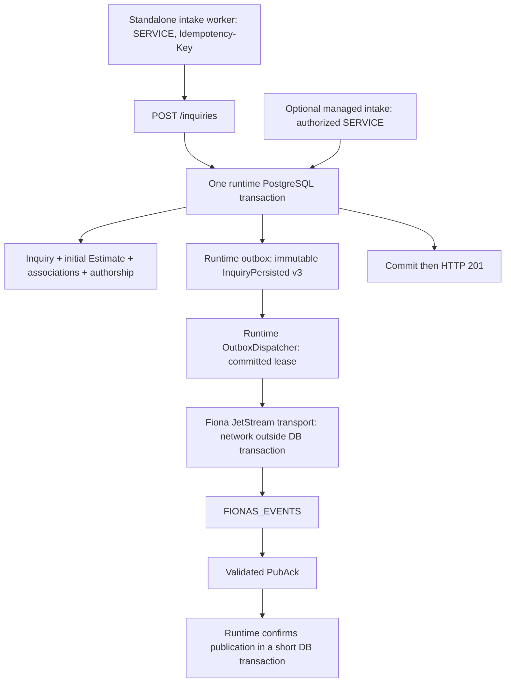

# Commerce-owned inquiry events

Both `POST /inquiries` and optional [integrated intake](inquiry-intake.md) invoke
`CreateInquiry`, which commits the submission-key claim, customer association, inquiry and
requested service, canonical initial Estimate, financial association, line authorship,
and one `InquiryPersisted v3` event in the same PostgreSQL transaction. A valid **201
confirms all of these durable facts**. It does not confirm NATS publication. The request
does no network I/O to NATS. Failed business writes or failed event append roll everything
back, including the submission key. Identical replay returns the original receipt and
appends nothing; changed intent retains `409 IDEMPOTENCY_KEY_REUSED`.

`DeclineInquiry` (`POST /inquiries/{inquiryId}/decline`) likewise commits the decline fact and
one `InquiryDeclined v1` event in one transaction; see [InquiryDeclined v1](#inquirydeclined-v1).



Fiona consumes released `commerce-runtime:0.0.26` and its matching transitive domain.
Runtime owns additive `commerce/V2__transactional_outbox.sql` and
`commerce/V3__outbox_jsonb_payload.sql`. V3 converts the existing payload column from text
to JSONB, requiring top-level objects. Valid historical v2 objects retain their business
meaning, identities, destinations and delivery state. Invalid JSON, non-object values,
unsupported Unicode or JSONB numeric ranges fail migration; inspect and resolve such
history under an explicit operator policy before deployment. Never silently delete it.
No Fiona migration, copied runtime SQL, extra pool or local outbox table is needed.
Runtime migrations still precede Fiona migrations and composition.

## Contract and delivery

The application-owned [AsyncAPI contract](../asyncapi.json) describes the active v3 event and the immutable historical v2 contract:

| Fact | Value |
|---|---|
| Subject | `fionas.events.inquiry.persisted.v3` |
| Type / schema version | `fionas.inquiry.persisted` / `3` |
| Source / runtime producer | `fionas-commerce` |
| Aggregate | type `inquiry`, ID = inquiry UUID |
| Event ID | Fresh globally unique UUID, equal to runtime outbox ID and `Nats-Msg-Id` |
| Correlation ID | Original exact opaque, case-sensitive `Idempotency-Key`, including non-UUID keys |
| Occurrence | Persisted inquiry `createdAt` (UTC, microseconds), never delivery time |
| Aggregate sequence | Runtime-assigned positive sequence in payload `aggregate.sequence`, equal to outbox `aggregate_sequence` and `Fionas-Aggregate-Sequence` |
| Data | Inquiry (ID, event date/type, ZIP, nullable message), canonical customer (ID/name/email), complete requested service, exact initial Estimate |

The snapshot is constructed synchronously by `outbox.append(transaction, draft) { sequence ->
... }`, using the runtime's authoritative sequence. It uses the recorded inquiry, canonical
customer, accepted requested service and the exact document returned by initial Estimate
materialization, all within the same operation transaction. The callback performs no
repository reads, network I/O, nested transaction or independent retry. A construction,
validation or append failure rolls back all writes, including the key and sequence.
Replay returns before generating event IDs or invoking the callback, including historical
submissions; it never backfills v3.

Returning customers retain their stored name; the event uses that canonical customer,
without exposing the record in the public HTTP receipt. Requested service retains guest
count/minimum flag, nullable duration and pricing reference, and ordered item labels with
nullable group/key. These are descriptive history, never catalog or pricing inputs.

The initial Estimate contains its actual document ID, version, stage, currency and ordered
lines with generated persisted IDs, descriptions, nullable sub-descriptions and quantities,
unit prices, whole-line tax amounts and domain-derived total. Currency comes from the
actual document (USD for web estimates); existing currency acceptance is unchanged.
Every monetary amount and quantity is an exact plain decimal **string**. A rate such as
`0.125` multiplied by `4` remains exact; event creation never rounds or reprices. This is
an Estimate, with no Quote, Invoice, booking, deposit or payment implications.

All payload properties are required; legitimate absences serialize explicitly as JSON null.
Dedicated versioned event DTOs own the wire shape, separate from HTTP and repository DTOs.
The event is a `JsonObject` persisted as JSONB. PostgreSQL may normalize whitespace and
object-key order; original Kotlin serialization bytes are not the persistence contract.
The adapter publishes exactly `record.payloadJson` encoded as UTF-8 on every attempt,
without reserialization, enrichment or current-state lookup.

The adapter sends these headers:

| Header | Meaning |
|---|---|
| `Nats-Msg-Id` | Stable outbox event UUID on every attempt |
| `Nats-Expected-Stream` | `FIONAS_EVENTS`; publication is constrained to this stream |
| `Fionas-Producer-Id` | Persisted producer ID, `fionas-commerce` |
| `Fionas-Aggregate-Type` | Persisted aggregate type, `inquiry` |
| `Fionas-Aggregate-Id` | Persisted inquiry UUID |
| `Fionas-Aggregate-Sequence` | Runtime-assigned positive decimal business sequence, normally `1` at creation |

The [official Java client 2.26.4](https://github.com/nats-io/nats.java/releases/tag/2.26.4)
performs synchronous bounded JetStream publication. Only a parsed PubAck naming
`FIONAS_EVENTS` with positive stream sequence returns `CONFIRMED`. A valid duplicate PubAck
also confirms acceptance. Malformed responses, wrong stream, denied permissions,
connection loss, timeouts and ambiguous outcomes all leave the durable event retryable.

The client uses commerce-runtime's existing `bcprov-jdk18on` crypto provider. Its transitive
`bcprov-lts8on` artifact is excluded because it supplies duplicate classes under a different
artifact name. Dependency uniqueness and NATS NKey signing/verification are tested.

Delivery is **at least once**, including broker acceptance followed by process failure or
failed database confirmation. Broker deduplication is finite: consumers must persist their
own processed event IDs before irreversible effects.

Event UUID is global identity. `occurredAt` is when Fiona recorded the business fact, not
when delivery happened. Runtime sequence orders events within
`(producerId, aggregateType, aggregateId)`; it is neither global across inquiries nor a
financial document revision nor the JetStream stream sequence. The sequence in v3 JSON,
outbox storage and NATS aggregate-sequence header must agree.

The runtime will not attempt an aggregate successor before confirming its predecessor.
This does not guarantee consumer processing order. Consumers must tolerate duplicates,
delays, out-of-order processing, missing predecessors, restarts and retries after newer
events have been processed. Consumers own their correctness strategy:

- A latest-state projection may ignore stale snapshots after accepting newer state.
- A payment consumer must retain every unique financial fact even at an older sequence.
- A notification consumer may consult authoritative current state before acting on an old event.
- An observational history preserves every unique fact and its business occurrence time.

A business event contains the authoritative snapshot needed to understand its intended
meaning without replaying earlier events. Decisions that depend on what is true now may
still require current authoritative state. No consumer sequencing infrastructure lives here.

## InquiryDeclined v1

A staff user's decline of a REQUESTED inquiry appends exactly one `InquiryDeclined v1` in the
same transaction that inserts the decline, after the canonical association lock and the
REQUESTED check. A stale, repeated or illegal decline (`409`) and any rollback append nothing.
The same runtime dispatcher, `NatsOutboxTransport`, headers, PubAck validation and retry policy
publish it unchanged; nothing about delivery is specific to this event.

| Fact | Value |
|---|---|
| Subject | `fionas.events.inquiry.declined.v1` |
| Type / schema version | `fionas.inquiry.declined` / `1` |
| Source / runtime producer | `fionas-commerce` |
| Aggregate | type `inquiry`, ID = inquiry UUID: the **same** aggregate as InquiryPersisted |
| Event ID | Fresh UUID, equal to runtime outbox ID and `Nats-Msg-Id` (broker deduplication identity) |
| Correlation ID | None: a decline has no submission key |
| Occurrence | Decline time (UTC, microseconds), equal to `data.decline.declinedAt` |
| Aggregate sequence | The runtime's next sequence for the inquiry, normally `2` after InquiryPersisted's `1`; never assumed or hardcoded |
| Data | Inquiry (ID, `createdAt`, `stage` `DECLINED`, event date/type, ZIP, nullable message), decline (`declinedAt`, `declinedBy` `{kind: USER, id}`, internal `reason`), canonical customer, complete requested service, the exact declined canonical Estimate |

The Estimate is the canonical snapshot the staff user reviewed (`expectedDocumentVersion`),
which may be a later Estimate version after staff edits; its lines keep their persisted IDs and
exact decimal strings. The snapshot is independently interpretable: a consumer that never saw
InquiryPersisted v3 can still record the decline. Its DTOs (`events/InquiryDeclined.kt`) are
separate from the v3 DTOs, so neither contract constrains the other.

Because the runtime publishes an aggregate's successor only after confirming its predecessor,
a decline is not published before its inquiry's InquiryPersisted. Consumers still deduplicate
by event UUID and must tolerate a decline arriving before they processed the persisted event
(for example after their own restart), and duplicates after either.

## Enablement and lifecycle

| Variable | Meaning |
|---|---|
| `FIONAS_OUTBOX_PUBLISHER_ENABLED` | Exactly `true` or `false`; absent defaults to `false` |
| `FIONAS_NATS_URL` | Required when enabled: one `nats://` or `tls://` server URL, without embedded credentials, path, query or fragment |
| `FIONAS_NATS_CREDS_FILE` | Optional readable mounted JWT/NKey credentials file |
| `FIONAS_NATS_USER`, `FIONAS_NATS_PASSWORD` | Optional nonblank pair for a dedicated per-user identity |
| `FIONAS_NATS_TOKEN` | Optional nonblank preshared server token |

Configure at most one authentication method: credentials file, user/password, or token.
Use a dedicated NATS publisher identity in the same account as `FIONAS_EVENTS`. Prefer
mounted credentials and `tls://` with certificates trusted by the JVM in nonlocal
environments. A token server (`authorization { token: ... }`) gives every client the same
unscoped identity, so the least-privilege allow-list below cannot be enforced for the
publisher; use a token only where the server offers no per-identity credentials.
Unauthenticated connections are supported for isolated local development. No trust-all
TLS option is introduced. Do not embed credentials in the URL, image, JAR, source, or
logging configuration.

Disabled publication still appends events. There is no background service or connection;
pending events remain durable until enabled. When enabled, missing/invalid settings fail
composition clearly. Ordinary broker unavailability is a retryable delivery failure and
does not prevent application startup or inquiry commit. OpenAPI rendering and handler
construction never connect to NATS.

The composition root contributes `InquiryOutboxPublisher` through the runtime's
`ApplicationContributions.backgroundServices`. It uses the same context/pool. Logical
producer ID is stable across deployments; publisher ID is a fresh process-instance UUID.
No coordinated identity service is needed; runtime leases and fencing tokens arbitrate
concurrency. Runtime `start()` starts HTTP and then dispatch. Runtime `close()` stops HTTP,
closes the service (dispatcher first, owned transport next), and closes the pool last.
Transport close is safe before start and idempotent. Graceful supervisor termination should
allow at least 30 seconds for bounded dispatcher/database and connection shutdown with
intake disabled, and at least 100 seconds with integrated intake enabled.

Initial deployment settings are explicit Kotlin composition values: batch size `1`, poll
interval `1s`, lease `60s`, outer publish timeout `5s`, exponential retry starting at `1s`
and capped at `5m`. Within the outer timeout, the adapter bounds initial connection at `1s`,
socket writes at `1s`, and PubAck request at `3s`. Established connections reconnect
automatically; initial connection failure is retried lazily on later dispatcher attempts.
Reconnect message buffering is disabled: PostgreSQL remains the durable queue. Attempts
never exhaust into dropped events.

## NATS provisioning and least privilege

Commerce does not provision or inspect streams on startup. Use the existing
[event-worker operator tooling](https://github.com/castab/fionas-event-workers#operator-provisioning-and-service-setup)
to provision/verify `FIONAS_EVENTS` with subjects `fionas.events.>`. Do not add another stream.

Provision a distinct publisher identity, separate from the web publisher, intake worker,
operator/admin identity, and commerce SERVICE credential. For the selected Java client's
plain JetStream publish request/reply path, the complete required allow-list is:

```hocon
# Merge this identity into your existing account configuration through operator tooling.
# Password is an operator-supplied secret/hash; this is not a deployable credential.
{
  user: "fionas-commerce-outbox"
  password: $COMMERCE_OUTBOX_NATS_PASSWORD
  permissions: {
    publish: ["fionas.events.inquiry.persisted.v3", "fionas.events.inquiry.declined.v1"]
    subscribe: ["_INBOX.>"]
  }
}
```

The normal new-event grant is the two current subjects. **Add
`fionas.events.inquiry.declined.v1` before the first decline:** without it the decline still
commits, but its event stays pending and retrying, and because successors wait for their
predecessors, any later event of that inquiry waits behind it. During upgrade, if unpublished v2 rows remain,
temporarily grant **both** `fionas.events.inquiry.persisted.v2` and
`fionas.events.inquiry.persisted.v3`. The dispatcher continues publishing stored v2 rows
to their original destination with their original identity and JSONB content; it never
rewrites, suppresses, re-appends or dual-publishes them. Remove the v2 grant only after
its pending backlog drains. JSONB formatting changes do not change historical meaning.

For JWT/NKey accounts express the same publish and subscribe allow-lists in the user JWT.
The client's synchronous publish creates a reply inbox and publishes directly to the
business subject with `Nats-Expected-Stream`; it needs **no `$JS.API.>` permissions**, stream
INFO/CREATE/UPDATE/DELETE access, consumer administration, or publish permission on inboxes.
The broker sends PubAck to the publisher's subscribed inbox. This grant is exercised against
an authenticated real server in `NatsOutboxIntegrationSpec`. See
[NATS authorization](https://docs.nats.io/learn/security/authorization).

Remove the intake worker's `fionas.events.inquiry.persisted.v1` publish grant after cutover.
Retain only the unrelated grants that the revised worker still needs; commerce does not
alter production account configuration itself.

## Diagnostics, privacy and retention

Use the shared runtime's structured `outbox_events_claimed`, `outbox_publication_confirmed`,
`outbox_publication_failed` and `outbox_dispatch_failed` logs. Fiona adds connection-state
and closed error-code logs; it never logs payloads, contacts, raw server errors, exception
messages, NATS passwords or credential-file contents. Do not enable wire tracing.

Within a trusted operator/diagnostic integration that already has a composed runtime
context, read `context.outbox.backlog("fionas-commerce")`. This payload-free, producer-scoped
snapshot exposes:

| Field | Meaning / operational action |
|---|---|
| `unpublished` | Total pending backlog; alert on sustained growth |
| `oldestUnpublishedAt` | Oldest pending **recorded** timestamp; alert on increasing age (initial threshold: five minutes) |
| `claimed` | Currently live leased events |
| `retryEligible` | Eligible aggregate heads available for publication |
| `waitingForRetry` | Records delayed until their next retry time |
| `failed` | Pending records carrying a publication failure code |

This is a supported in-process diagnostic API, including a caller-transaction overload.
There is no new public HTTP endpoint, separate poller or retention scheduler. Wire these
fields into existing private operational monitoring, alert on delivery failures and oldest
age, and check them when enabling the publisher; HTTP health alone does not demonstrate
delivery. On increasing backlog, inspect safe failure codes, NATS reachability, grants,
stream existence and storage limits. Repair the cause and let the dispatcher reclaim/retry.
Never clear pending rows to silence alerts.

Customer ID/name/email, customer-written messages, ZIP codes, service selections, detailed
Estimate prices/lines and internal decline reasons are sensitive personal and commercial
information in **both** PostgreSQL outbox payloads and NATS. A decline reason is a staff note,
never a customer message; no consumer should forward it to customers. This is a deliberate business snapshot, not a public notification.
Restrict `FIONAS_EVENTS` consumers to trusted systems with an actual need for the data,
limit database and account access, and protect backups. Never log full payloads, contact
information, messages or pricing details. Credentials, tokens, raw HTTP headers, client IPs
and unrelated customer history are excluded.
The event-worker stream provisioning defaults are file storage, limits retention, **30 days**
max age, **24 hours** duplicate window and disabled deletion/purge/rollup; operators must
verify the actual stream settings and align retention with the deployment's policy.
Broker retention and duplicate windows are independent of PostgreSQL retention.
The runtime **does not automatically purge published outbox rows**. PostgreSQL payloads and
backups remain until an explicit future retention policy is approved and implemented.
That policy must retain all unpublished events and aggregate counters. This milestone adds
no cleanup scheduler or purge operation.

## Historical cutover to commerce-owned success publication

For the subsequent intake ownership transfer into commerce, use the
[integrated intake deployment/cutover/rollback checklist](inquiry-intake.md#deployment-cutover-and-rollback-checklist).
The sequence below records the earlier success-publication ownership migration.

Companion: [fionas-event-workers PR #3](https://github.com/castab/fionas-event-workers/pull/3).
Its worker ACKs input after a valid commerce HTTP 201 and no longer publishes success.
It deliberately does not verify NATS success delivery: the committed commerce outbox owns it.

1. Confirm the deployable artifact resolves released runtime/domain v0.0.26; run the build,
   OpenAPI generation, event contract and packaging checks.
2. Preflight historical payloads for the runtime V3 JSONB migration. Ensure every payload is
   a valid JSON object compatible with PostgreSQL JSONB; take the normal deployment backup.
3. Verify existing `FIONAS_EVENTS` covers `fionas.events.>`; do not create a new stream.
4. Provision the dedicated publisher's v3 grant and `_INBOX.>` subscription. Temporarily retain
   v2 publish permission if historical unpublished v2 events remain.
5. Deploy commerce and let runtime V3 migrate before serving; enable its outbox dispatcher.
6. Submit a synthetic inquiry. Verify v3 subject, event identity, complete snapshot against
   committed state, and agreement between JSON/outbox/header aggregate sequence.
7. Verify backlog drainage, including historical v2 rows on their original subject. Inspect
   safe failure diagnostics; HTTP health alone is insufficient.
8. Deploy worker PR #3 only after commerce publication has been verified. Never remove the
   worker's success publication first.
9. Remove obsolete worker v1 grants after ownership cutover; remove commerce v2 grants after
   historical v2 drainage. Retain only normal v3 permission and unrelated required grants.

An ownership overlap can expose worker-owned v1 and commerce-owned success events for the
same inquiry; these are not separate creations. There is no permanent legacy adapter or
dual publication. Historical submissions under v2 or before outbox adoption replay without
new events. Any backfill requires a separate explicit operation. This PR changes no
production configuration and does not deploy either application.

No other lifecycle events or notification consumers are implemented. Proposal issuance and
revision are intended follow-up event slices, followed separately by booking, payment,
fulfillment and closure, sharing the runtime's inquiry aggregate identity and sequence.
