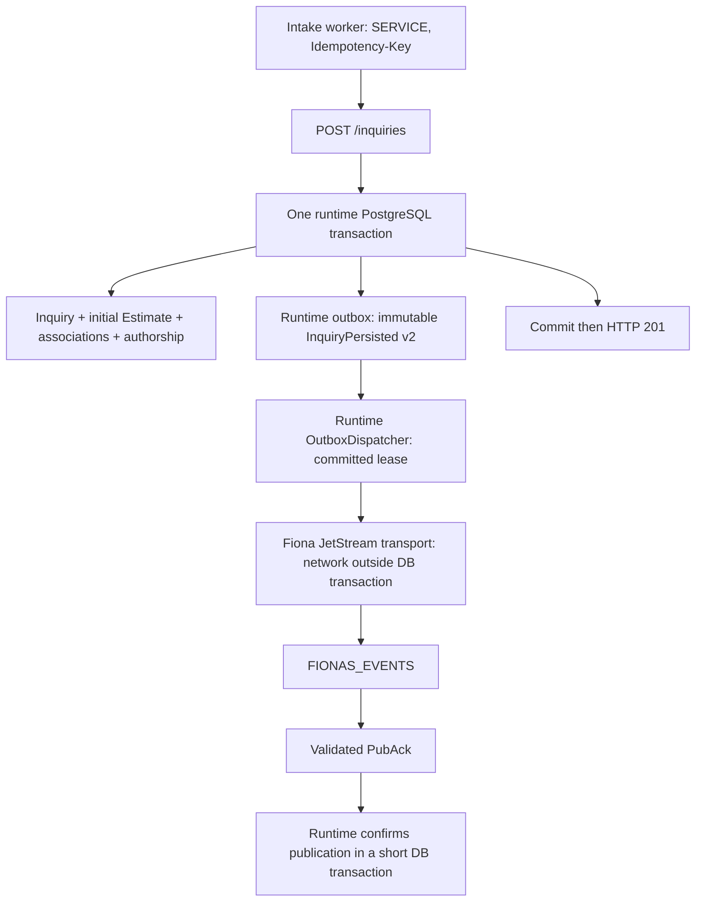

# Commerce-owned inquiry events

`POST /inquiries` now commits the submission-key claim, customer association, inquiry and
requested service, canonical initial Estimate, financial association, line authorship,
and one `InquiryPersisted v2` event in the same PostgreSQL transaction. A valid **201
confirms all of these durable facts**. It does not confirm NATS publication. The request
does no network I/O to NATS. Failed business writes or failed event append roll everything
back, including the submission key. Identical replay returns the original receipt and
appends nothing; changed intent retains `409 IDEMPOTENCY_KEY_REUSED`.



Fiona consumes `commerce-runtime:0.0.24`, including its additive
`commerce/V2__transactional_outbox.sql`. Existing V1 databases upgrade normally; no new
Fiona migration, database reset, copied runtime migration, or local outbox table is needed.
Runtime migrations still precede Fiona migrations and composition.

## Contract and delivery

The application-owned [AsyncAPI contract](../asyncapi.json) describes exactly one event:

| Fact | Value |
|---|---|
| Subject | `fionas.events.inquiry.persisted.v2` |
| Type / schema version | `fionas.inquiry.persisted` / `2` |
| Source / runtime producer | `fionas-commerce` |
| Aggregate | type `inquiry`, ID = inquiry UUID |
| Event ID | Fresh globally unique UUID, equal to runtime outbox ID and `Nats-Msg-Id` |
| Correlation ID | Original exact opaque, case-sensitive `Idempotency-Key`, including non-UUID keys |
| Occurrence | Persisted inquiry `createdAt` (UTC, microseconds), never delivery time |
| Data | inquiry UUID, canonical stored customer name and normalized email, recorded event date |

No message, ZIP, requested-service selections, money, priced lines, credentials, or totals
are included. Returning customers retain their stored name; the event describes that
canonical record rather than their newly submitted name. The serialized payload is stored
once as opaque immutable text. Delivery sends its exact UTF-8 bytes.

The adapter sends these headers:

| Header | Meaning |
|---|---|
| `Nats-Msg-Id` | Stable outbox event UUID on every attempt |
| `Nats-Expected-Stream` | `FIONAS_EVENTS`; publication is constrained to this stream |
| `Fionas-Producer-Id` | Persisted producer ID, `fionas-commerce` |
| `Fionas-Aggregate-Type` | Persisted aggregate type, `inquiry` |
| `Fionas-Aggregate-Id` | Persisted inquiry UUID |
| `Fionas-Aggregate-Sequence` | Runtime-assigned positive decimal business sequence, normally `1` at creation |

The [official Java client 2.26.4](https://github.com/nats-io/nats.java/releases/tag/2.26.4)
performs synchronous bounded JetStream publication. Only a parsed PubAck naming
`FIONAS_EVENTS` with positive stream sequence returns `CONFIRMED`. A valid duplicate PubAck
also confirms acceptance. Malformed responses, wrong stream, denied permissions,
connection loss, timeouts and ambiguous outcomes all leave the durable event retryable.

The client uses commerce-runtime's existing `bcprov-jdk18on` crypto provider. Its transitive
`bcprov-lts8on` artifact is excluded because it supplies duplicate classes under a different
artifact name. Dependency uniqueness and NATS NKey signing/verification are tested.

Delivery is **at least once**, including broker acceptance followed by process failure or
failed database confirmation. Broker deduplication is finite: consumers must persist their
own processed event IDs before irreversible effects. The runtime sequences events within
`(producerId, aggregateType, aggregateId)` and will not attempt a successor before confirming
its predecessor. Late duplicate sends may still arrive out of order. Consumers should use
aggregate sequence where appropriate; JetStream stream sequence is a separate broker fact.

## Enablement and lifecycle

| Variable | Meaning |
|---|---|
| `FIONAS_OUTBOX_PUBLISHER_ENABLED` | Exactly `true` or `false`; absent defaults to `false` |
| `FIONAS_NATS_URL` | Required when enabled: one `nats://` or `tls://` server URL, without embedded credentials, path, query or fragment |
| `FIONAS_NATS_CREDS_FILE` | Optional readable mounted JWT/NKey credentials file; exclusive with user/password |
| `FIONAS_NATS_USER`, `FIONAS_NATS_PASSWORD` | Optional nonblank pair for a dedicated per-user identity |

Use a dedicated NATS publisher identity in the same account as `FIONAS_EVENTS`. Prefer
mounted credentials and `tls://` with certificates trusted by the JVM in nonlocal
environments. Unauthenticated connections are supported for isolated local development.
No preshared token mode or trust-all TLS option is introduced. Do not embed credentials in
the URL, image, JAR, source, or logging configuration.

Disabled publication still appends events. There is no background service or connection;
pending events remain durable until enabled. When enabled, missing/invalid settings fail
composition clearly. Ordinary broker unavailability is a retryable delivery failure and
does not prevent application startup or inquiry commit. OpenAPI rendering and handler
construction never connect to NATS.

The composition root contributes `InquiryOutboxPublisher` through the runtime's
`ApplicationContributions.backgroundServices`. It uses the same context/pool. Logical
producer ID is stable across deployments; publisher ID is a fresh process-instance UUID.
No coordinated identity service is needed; runtime leases and fencing tokens arbitrate
concurrency. Runtime `start()` starts HTTP and then dispatch. Runtime `close()` stops HTTP,
closes the service (dispatcher first, owned transport next), and closes the pool last.
Transport close is safe before start and idempotent. Graceful supervisor termination should
allow at least 30 seconds for bounded dispatcher/database and connection shutdown.

Initial deployment settings are explicit Kotlin composition values: batch size `1`, poll
interval `1s`, lease `60s`, outer publish timeout `5s`, exponential retry starting at `1s`
and capped at `5m`. Within the outer timeout, the adapter bounds initial connection at `1s`,
socket writes at `1s`, and PubAck request at `3s`. Established connections reconnect
automatically; initial connection failure is retried lazily on later dispatcher attempts.
Reconnect message buffering is disabled: PostgreSQL remains the durable queue. Attempts
never exhaust into dropped events.

## NATS provisioning and least privilege

Commerce does not provision or inspect streams on startup. Use the existing
[event-worker operator tooling](https://github.com/castab/fionas-event-workers#operator-provisioning-and-service-setup)
to provision/verify `FIONAS_EVENTS` with subjects `fionas.events.>`. Do not add another stream.

Provision a distinct publisher identity, separate from the web publisher, intake worker,
operator/admin identity, and commerce SERVICE credential. For the selected Java client's
plain JetStream publish request/reply path, the complete required allow-list is:

```hocon
# Merge this identity into your existing account configuration through operator tooling.
# Password is an operator-supplied secret/hash; this is not a deployable credential.
{
  user: "fionas-commerce-outbox"
  password: $COMMERCE_OUTBOX_NATS_PASSWORD
  permissions: {
    publish: ["fionas.events.inquiry.persisted.v2"]
    subscribe: ["_INBOX.>"]
  }
}
```

For JWT/NKey accounts express the same publish and subscribe allow-lists in the user JWT.
The client's synchronous publish creates a reply inbox and publishes directly to the
business subject with `Nats-Expected-Stream`; it needs **no `$JS.API.>` permissions**, stream
INFO/CREATE/UPDATE/DELETE access, consumer administration, or publish permission on inboxes.
The broker sends PubAck to the publisher's subscribed inbox. This grant is exercised against
an authenticated real server in `NatsOutboxIntegrationSpec`. See
[NATS authorization](https://docs.nats.io/learn/security/authorization).

Remove the intake worker's `fionas.events.inquiry.persisted.v1` publish grant after cutover.
Retain only the unrelated grants that the revised worker still needs; commerce does not
alter production account configuration itself.

## Diagnostics, privacy and retention

Use the shared runtime's structured `outbox_events_claimed`, `outbox_publication_confirmed`,
`outbox_publication_failed` and `outbox_dispatch_failed` logs. Fiona adds connection-state
and closed error-code logs; it never logs payloads, contacts, raw server errors, exception
messages, NATS passwords or credential-file contents. Do not enable wire tracing.

Within a trusted operator/diagnostic integration that already has a composed runtime
context, read `context.outbox.backlog("fionas-commerce")`. This payload-free, producer-scoped
snapshot exposes:

| Field | Meaning / operational action |
|---|---|
| `unpublished` | Total pending backlog; alert on sustained growth |
| `oldestUnpublishedAt` | Oldest pending **recorded** timestamp; alert on increasing age (initial threshold: five minutes) |
| `claimed` | Currently live leased events |
| `retryEligible` | Eligible aggregate heads available for publication |
| `waitingForRetry` | Records delayed until their next retry time |
| `failed` | Pending records carrying a publication failure code |

This is a supported in-process diagnostic API, including a caller-transaction overload.
There is no new public HTTP endpoint, separate poller or retention scheduler. Wire these
fields into existing private operational monitoring, alert on delivery failures and oldest
age, and check them when enabling the publisher; HTTP health alone does not demonstrate
delivery. On increasing backlog, inspect safe failure codes, NATS reachability, grants,
stream existence and storage limits. Repair the cause and let the dispatcher reclaim/retry.
Never clear pending rows to silence alerts.

Name and email are personal data in **both** PostgreSQL outbox payloads and NATS. Restrict
database and NATS account access, authorize only intended consumers, and protect backups.
The event-worker stream provisioning defaults are file storage, limits retention, **30 days**
max age, **24 hours** duplicate window and disabled deletion/purge/rollup; operators must
verify the actual stream settings and align retention with the deployment's policy.
Broker retention and duplicate windows are independent of PostgreSQL retention.
The runtime **does not automatically purge published outbox rows**. PostgreSQL payloads and
backups remain until an explicit future retention policy is approved and implemented.
That policy must retain all unpublished events and aggregate counters. This milestone adds
no cleanup scheduler or purge operation.

## Coordinated cutover

Companion: [fionas-event-workers PR #3](https://github.com/castab/fionas-event-workers/pull/3).
Its worker ACKs input after a valid commerce HTTP 201 and no longer publishes success.
It deliberately does not verify NATS success delivery: the committed commerce outbox owns it.

1. Verify the released runtime dependency and this integration's build/tests.
2. Provision/verify `FIONAS_EVENTS` and the dedicated commerce publisher identity.
3. Deploy commerce; allow runtime V2 migration and transactional event append.
4. Enable the commerce publisher. Verify v2 messages in JetStream and draining backlog.
5. Deploy worker PR #3 only after verifying commerce publication.
6. Remove the retired v1 success publish permission from the intake worker and verify it
   no longer publishes success. Commerce is the sole authoritative success producer.

Short overlap can expose both worker-owned v1 and commerce-owned v2 for one inquiry;
these are not two business creations. Consumers must account for the version transition.
There is no permanent legacy mode or compatibility bridge. An old retained submission
may replay an inquiry committed before event append existed: replay still writes nothing.
Historical events, if needed, require a separate explicit backfill decision.

No other lifecycle events or notification consumers are implemented. Proposal issuance and
revision are intended follow-up event slices, followed separately by booking, payment,
fulfillment and closure, sharing the runtime's inquiry aggregate identity and sequence.
